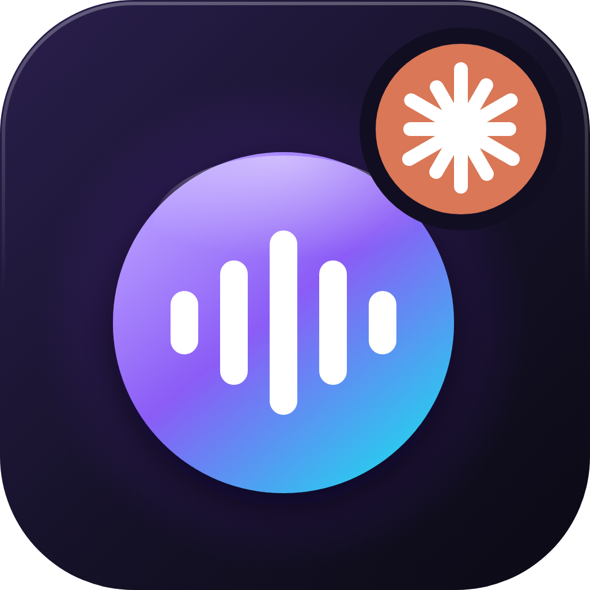

<p align="center">
  
</p>

<h1 align="center">Desk AI</h1>

<p align="center">
  Asistente de voz para Windows tipo Jarvis: mantén <b>Ctrl+Win</b>, habla, y Claude ve tu pantalla,
  te responde en voz alta y controla tu PC — sin sacar las manos del juego.
</p>

<p align="center">
  <a href="https://desk-ai-pi.vercel.app">Sitio web</a> ·
  <a href="#instalación">Instalación</a> ·
  <a href="#qué-puede-hacer">Qué puede hacer</a> ·
  <a href="LICENSE">MIT</a>
</p>

> **English:** Desk AI is a push-to-talk desktop voice assistant for Windows. Hold Ctrl+Win, speak, and Claude sees
> your screen, answers out loud and controls your PC (Spotify, YouTube, Discord, windows, timers…). Speech-to-text runs
> locally with Whisper on your GPU; answers use your Claude subscription through Claude Code (no API key). The UI and
> prompts are in Spanish for now — PRs for other languages are welcome.

## Cómo funciona

1. **Mantén Ctrl+Win y habla.** Se graba el micrófono y se toma una captura de la pantalla.
2. **Whisper transcribe en tu GPU** (`large-v3-turbo`, local y gratis). Si un juego está acaparando la GPU, un modelo
   chico en la CPU entra de respaldo.
3. **Claude responde** usando tu suscripción mediante [Claude Code](https://claude.com/claude-code) (`claude -p`), sin
   API key. Cada consulta parte en Opus con esfuerzo bajo y, si es compleja, la responde con más esfuerzo. Solo mira
   la captura si la necesita, para ahorrar tokens.
4. **Lo escuchas en voz alta** (edge-tts) mientras sigues jugando, y la respuesta aparece en un overlay que no le
   quita el foco al juego.

## Qué puede hacer

- **Ayudarte en el juego** mirando tu pantalla: builds, estrategia, misiones. Busca el parche actual en la web una vez
  por juego para no recomendar cosas eliminadas.
- **Música:** reproducir canciones o tus playlists en Spotify, pausar, saltar, dar me gusta, agregar a una lista.
- **YouTube:** buscar y reproducir videos, pausar, adelantar, velocidad, subtítulos, cerrar pestañas que suenan.
- **Discord y micrófono:** silenciarte o ensordecerte.
- **Ventanas y apps:** abrir, cerrar, mover a otra pantalla o a media pantalla, abrir carpetas y webs.
- **Temporizadores y recordatorios** por voz ("avísame en 5 minutos que salga el dragón").
- **Capturas y clips** del juego, **estado del PC** (CPU, GPU, memoria, batería), **cambiar audífonos/parlantes**.
- **Dictar texto** en la ventana que estabas usando, y **rutinas** que agrupan varias acciones.
- Entiende transcripciones imperfectas: si Whisper oye "la tracks en el leage", deduce "Tristana en League of Legends".

Spotify, Discord, YouTube y Chrome se controlan con UI Automation de Windows: no hace falta ninguna API ni clave.

## Instalación

Requisitos: **Windows 10/11**, **Python 3.11+**, una **GPU NVIDIA** (recomendado; funciona en CPU, más lento) y
**[Claude Code](https://claude.com/claude-code)** con sesión iniciada (`claude` → `/login`) en una suscripción de Claude.

```powershell
git clone https://github.com/farriagadal/desk-ai.git
cd desk-ai
pip install -r requirements.txt
copy .env.example .env   # opcional: ajustar modelos, atajos, voz…
pythonw app.py           # o doble clic en iniciar.bat
```

La primera vez descarga el modelo de Whisper (~1,5 GB). Desk AI queda en la bandeja del sistema (íconos ocultos):
clic para mostrar la ventana, clic derecho para el overlay, la voz o salir.

## Atajos

| Atajo | Acción |
| --- | --- |
| **Ctrl+Win** (mantener) | Captura + graba; al soltar transcribe y envía |
| F9 (mantener) | Solo graba y transcribe, sin enviar |
| F8 | Adjunta una captura de pantalla |
| F10 | Envía la consulta |
| F11 | Calla la voz / activa o desactiva la lectura en voz alta |
| F6 | Alterna entre la ventana y el overlay para jugar |

También por voz: "usa opus", "esfuérzate más", "modo automático".

## Configuración

Todo se ajusta en `.env` (ver [`.env.example`](.env.example)): modelos y esfuerzo de Claude, modelo de Whisper, atajos,
voz (`es-CL-CatalinaNeural`, `es-MX-DaliaNeural`…), posición del overlay, búsqueda web y acciones en el PC
(`PC_ACTIONS=0` las desactiva).

## Privacidad

El audio se transcribe **en tu PC**. A Anthropic solo llega el texto de tu consulta y, cuando Claude la pide, la
captura de pantalla. La voz usa el servicio gratuito de Microsoft Edge (edge-tts), que recibe el texto de la respuesta.
La ventana de Desk AI se excluye de sus propias capturas.

## Estructura

| Archivo | Qué hace |
| --- | --- |
| `app.py` | Ventana, overlay, grabación, Whisper, sesión con Claude y ruteo de modelos |
| `actions.py` | Acciones en el PC: Claude escribe `[[ACCION {json}]]` y la app las ejecuta |
| `hotkeys.py` | Atajos globales con un hook de teclado de bajo nivel |
| `tts.py` | Lectura en voz alta por frases mientras llega la respuesta |
| `tray.py` | Ícono en la bandeja del sistema |
| `ui/` | Interfaz (HTML/CSS/JS con pywebview) |
| `landing/` | Sitio web del proyecto |
| `assets/` | Logo e íconos en SVG (`logo-claude.svg` es la versión con la integración de Claude) |
| `tools/make_logo.py` | Genera los PNG/ICO a partir de los SVG |

## Licencia

[MIT](LICENSE) © 2026 Fernando Arriagada. Desk AI no está afiliado a Anthropic, Microsoft, Spotify, Discord ni Google.
